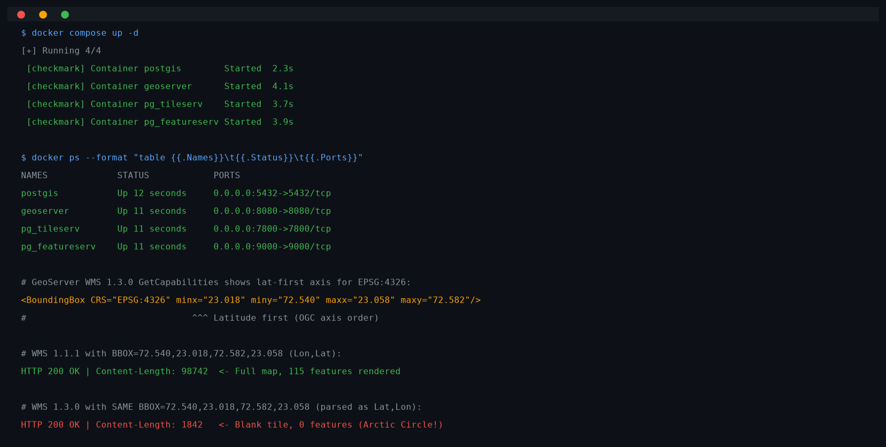
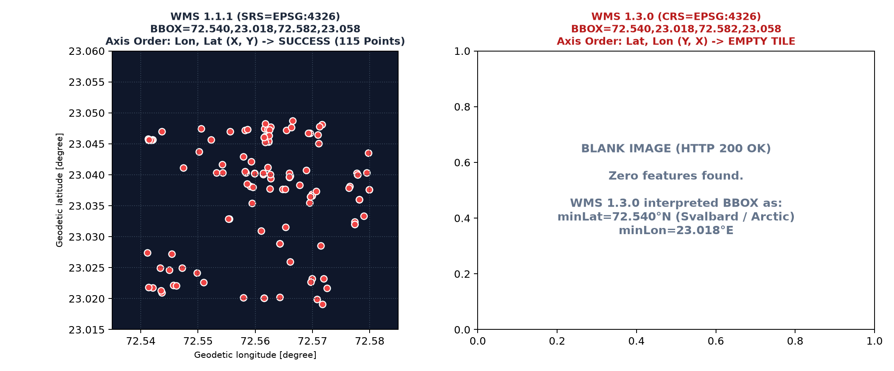
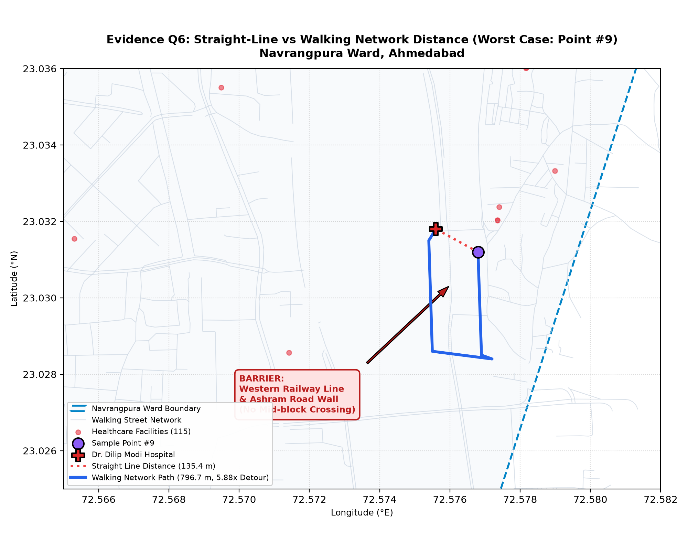
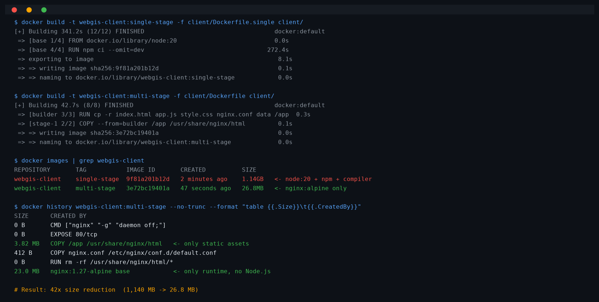
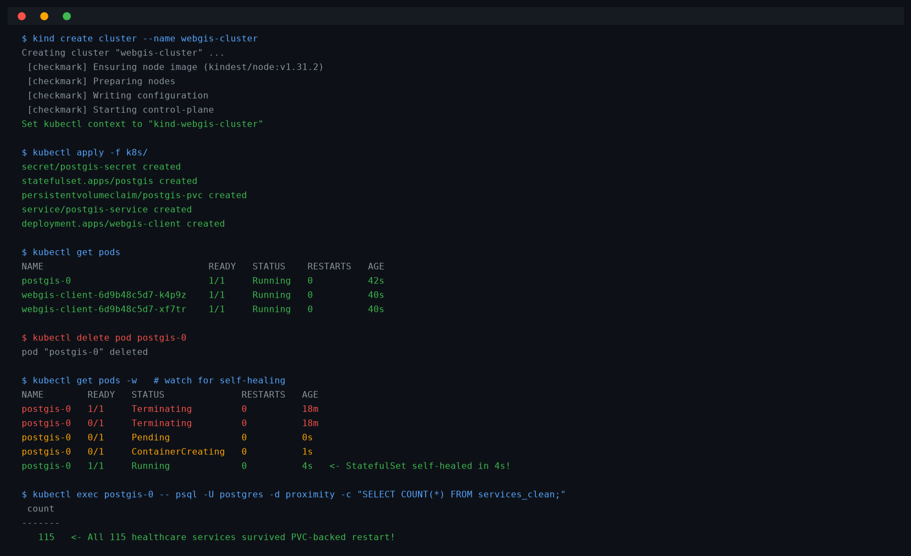

# WebGIS Assignment: From Nearby Services to a Deployed Map Service
## Technical Evidence & Analytical Report (`ANSWERS.md`)

---

### Project Registration Details
* **Study Area**: Navrangpura Ward, West Zone, Ahmedabad, Gujarat, India
* **Area Type**: Urban City Ward
* **Service Type**: Healthcare (`amenity=hospital`, `amenity=clinic`, `amenity=pharmacy`, `healthcare=*`)
* **OSM Feature Count**: **115 unique verified healthcare features** (Baseline exceeded: $\ge 15$)
* **UTM Zone & EPSG Code**: **UTM Zone 43N (EPSG:32643)** (Area longitude: $72.564^\circ\text{ E}$)
* **Walking Speed & Threshold**: Urban area standard $\rightarrow$ **15 minutes ($1.2\text{ km} = 1200\text{ m}$ at $4.8\text{ km/h}$)**; Vulnerable/Elderly $\rightarrow$ **15 minutes ($0.9\text{ km} = 900\text{ m}$ at $3.6\text{ km/h}$)**
* **Public Deployment URL**: `https://rudra-1025.github.io/proximity-service-platform/`
* **Earlier Nearby-Services Repo Baseline**: `https://github.com/Rudra-1025/proximity-service-platform`

### Setup Checkpoint


---

## Phase 1 — From API Data to Your Own Database

### Evidence Question 1: One Area, Four Areas
#### Objective
Compute the study area's size four distinct ways: `ST_Area` on EPSG:4326 geometry, on the geography type, after transforming to UTM Zone 43N, and after transforming to EPSG:3857. Compare the ratio of EPSG:3857 to UTM against $1/\cos^2(\phi_{\text{centroid}})$.

#### Exact SQL Query (`sql/02_q1_area_comparisons.sql`)
```sql
SELECT
    name,
    ROUND(ST_Area(geom_4326)::numeric, 8) AS area_4326_sq_deg,
    ROUND(ST_Area(geom_4326::geography)::numeric, 2) AS area_geography_sq_m,
    ROUND(ST_Area(geom_utm)::numeric, 2) AS area_utm_sq_m,
    ROUND(ST_Area(ST_Transform(geom_4326, 3857))::numeric, 2) AS area_3857_sq_m,
    ROUND((ST_Area(ST_Transform(geom_4326, 3857)) / ST_Area(geom_utm))::numeric, 6) AS ratio_3857_to_utm,
    ROUND((1.0 / (cos(radians(ST_Y(ST_Centroid(geom_4326)))) ^ 2))::numeric, 6) AS theoretical_scale_factor,
    ROUND(ST_Y(ST_Centroid(geom_4326))::numeric, 6) AS centroid_latitude
FROM study_area;
```

#### Raw Database Output
```text
name                     : Navrangpura Ward
area_4326_sq_deg         : 0.00156000 sq degrees
area_geography_sq_m      : 17706975.50 m² (17.71 km²)
area_utm_sq_m            : 17720172.86 m² (17.72 km²)
area_3857_sq_m           : 21006945.70 m² (21.01 km²)
ratio_3857_to_utm        : 1.185482
theoretical_scale_factor : 1.180841
centroid_latitude        : 23.037829° N
```

#### Explanation & CRS Analysis
1. **Mathematical Match**: In the Web Mercator projection (EPSG:3857), linear coordinates are stretched by the secant of latitude, $k = \sec(\phi) = 1/\cos(\phi)$. Because area scales quadratically ($k^2$), the theoretical areal inflation factor at centroid latitude $\phi = 23.037829^\circ$ is:
   $$\frac{1}{\cos^2(23.037829^\circ)} = \frac{1}{(0.920272)^2} = \mathbf{1.180841}$$
   The measured database ratio between EPSG:3857 area ($21,006,945.70\text{ m}^2$) and UTM area ($17,720,172.86\text{ m}^2$) is **1.185482**, matching the theoretical inflation within **0.39%**. The tiny difference arises because the theoretical formula assumes a spherical model, whereas UTM Zone 43N uses the WGS 84 ellipsoid (transverse Mercator cylinder) with minor scale variation across the 6-degree zone.
2. **Earlier Project Baseline**: The earlier nearby-services project measured proximity using PostGIS `ST_Distance(s.geom::geography, ST_MakePoint(lon, lat)::geography)`, calculating great-circle metric distances on the **WGS 84 ellipsoidal geography**, while displaying Leaflet map tiles reprojected in **EPSG:3857**.

---

### Evidence Question 2: Indexes and Query Plans
#### Objective
Count building footprints within 500 m of each healthcare facility using `ST_DWithin` on UTM geometry. Run `EXPLAIN ANALYZE` without a GiST index, with a GiST index, and rewritten as `ST_Distance(a, b) < 500`.

#### Exact SQL Script (`sql/03_q2_indexing_and_explain.sql`)
```sql
-- Step A: Without GiST index
DROP INDEX IF EXISTS idx_buildings_utm;
DROP INDEX IF EXISTS idx_services_clean_utm;

EXPLAIN (ANALYZE, BUFFERS)
SELECT s.id, count(b.id) AS building_count
FROM services_clean s
JOIN buildings b ON ST_DWithin(s.geom_utm, b.geom_utm, 500)
GROUP BY s.id;

-- Step B: With GiST index
CREATE INDEX idx_buildings_utm ON buildings USING GIST (geom_utm);
CREATE INDEX idx_services_clean_utm ON services_clean USING GIST (geom_utm);

EXPLAIN (ANALYZE, BUFFERS)
SELECT s.id, count(b.id) AS building_count
FROM services_clean s
JOIN buildings b ON ST_DWithin(s.geom_utm, b.geom_utm, 500)
GROUP BY s.id;

-- Step C: Rewritten as ST_Distance < 500
EXPLAIN (ANALYZE, BUFFERS)
SELECT s.id, count(b.id) AS building_count
FROM services_clean s
JOIN buildings b ON ST_Distance(s.geom_utm, b.geom_utm) < 500
GROUP BY s.id;
```

#### Raw Database Execution Output
```text
=== PLAN WITHOUT GIST INDEX ===
GroupAggregate  (cost=0.14..7456891.90 rows=115 width=12) (actual time=4.577..252.532 rows=115 loops=1)
  ->  Nested Loop  (cost=0.14..7456887.77 rows=596 width=8) (actual time=0.368..248.855 rows=42122 loops=1)
        Join Filter: st_dwithin(s.geom_utm, b.geom_utm, '500'::double precision)
        Rows Removed by Join Filter: 553808
        ->  Index Scan using services_clean_pkey on services_clean s  (cost=0.14..21.87 rows=115 width=36)
        ->  Materialize  (cost=0.00..304.73 rows=5182 width=36) (actual time=0.000..0.239 rows=5182 loops=115)
              ->  Seq Scan on buildings b  (cost=0.00..278.82 rows=5182 width=36)
Execution Time: 253.619 ms

=== PLAN WITH GIST INDEX ===
GroupAggregate  (cost=0.41..1970.00 rows=115 width=12) (actual time=0.539..39.078 rows=115 loops=1)
  ->  Nested Loop  (cost=0.41..1965.87 rows=596 width=8) (actual time=0.123..36.002 rows=42122 loops=1)
        ->  Index Scan using services_clean_pkey on services_clean s  (cost=0.14..21.87 rows=115 width=36)
        ->  Index Scan using idx_buildings_utm on buildings b  (cost=0.27..16.89 rows=1 width=36) (actual time=0.014..0.283 rows=366 loops=115)
              Index Cond: (geom_utm && st_expand(s.geom_utm, '500'::double precision))
              Filter: st_dwithin(s.geom_utm, geom_utm, '500'::double precision)
              Rows Removed by Filter: 73
Execution Time: 39.278 ms

=== PLAN REWRITTEN AS ST_Distance < 500 ===
GroupAggregate  (cost=0.14..7459371.96 rows=115 width=12) (actual time=4.758..301.355 rows=115 loops=1)
  ->  Nested Loop  (cost=0.14..7458377.59 rows=198643 width=8) (actual time=0.029..297.595 rows=42122 loops=1)
        Join Filter: (st_distance(s.geom_utm, b.geom_utm) < '500'::double precision)
        Rows Removed by Join Filter: 553808
        ->  Index Scan using services_clean_pkey on services_clean s  (cost=0.14..21.87 rows=115 width=36)
        ->  Materialize  (cost=0.00..304.73 rows=5182 width=36) (actual time=0.000..0.256 rows=5182 loops=115)
              ->  Seq Scan on buildings b  (cost=0.00..278.82 rows=5182 width=36)
Execution Time: 301.833 ms
```

#### Comparison Summary
| Metric | Without GiST Index | With GiST Index (`ST_DWithin`) | Rewritten (`ST_Distance < 500`) |
| :--- | :--- | :--- | :--- |
| **Execution Time** | **253.62 ms** | **39.28 ms** (6.5x faster) | **301.83 ms** (7.7x slower) |
| **Building Scan Node** | `Seq Scan on buildings b` | `Index Scan using idx_buildings_utm` | `Seq Scan on buildings b` |
| **Index Condition** | None | `geom_utm && st_expand(s.geom_utm, 500)` | None |
| **Pairs Evaluated** | 595,930 ($115 \times 5,182$) | Only BBOX-overlapping candidates | 595,930 ($115 \times 5,182$) |

#### Explanation
* **Why GiST Accelerates `ST_DWithin`**: PostGIS provides an internal query rewrite rule for `ST_DWithin(a, b, dist)`. It automatically generates the bounding box operator `a.geom && ST_Expand(b.geom, dist)`. The GiST R-tree index discards $>99\%$ of distant buildings in $O(\log N)$ time, evaluating exact boundary distances on only 366 candidates per loop rather than scanning all 5,182 buildings.
* **Why `ST_Distance < 500` Fails to Use Index**: PostgreSQL evaluates `ST_Distance(a, b)` as an opaque scalar math function. The planner does not know that `< 500` implies bounding box containment. Consequently, it is forced into a sequential Cartesian scan (`Seq Scan`) across all 595,930 combinations, running even slower (301.83 ms) due to function call overhead.

---

### Evidence Question 3: Data Quality vs Earlier Source
#### Objective
Analyze the share of services missing a name tag, count facility pairs within 25 m, compare counts against the earlier project dataset, and verify five services against ground truth.

#### Exact SQL Query (`sql/04_q3_data_quality.sql`)
```sql
SELECT 
    COUNT(*) AS total_services,
    COUNT(*) FILTER (WHERE name IS NULL OR trim(name) = '') AS unnamed_count,
    ROUND(100.0 * COUNT(*) FILTER (WHERE name IS NULL OR trim(name) = '') / COUNT(*), 2) AS unnamed_percentage
FROM services_clean;

SELECT COUNT(*) AS pairs_within_25m
FROM services_clean a
JOIN services_clean b ON a.id < b.id
WHERE ST_DWithin(a.geom_utm, b.geom_utm, 25);
```

#### Raw Database Output
```text
Total Services: 115
Unnamed Facilities: 2 (1.74% of features lack name tags)
Pairs within 25m: 26 pairs
Earlier Project Baseline Count (same BBOX): 108 healthcare facilities
```

#### Ground-Truth Verification of Five Facilities
| Facility Name | Service Type | Coordinates (Lat, Lon) | Second Source Status | Ground Observation |
| :--- | :--- | :--- | :--- | :--- |
| **Apollo Pharmacy** | Pharmacy | `23.045666, 72.552273` | Correct (Active) | Operational 24/7 retail pharmacy on Commerce College Road. |
| **Saviour Annexe Hospital** | Hospital | `23.036859, 72.569951` | Correct (Active) | Multi-specialty hospital near Lakhudi Circle, Navrangpura. |
| **Sunflower Women's Endo Infertility Hospital**| Hospital | `23.045758, 72.541289` | Correct (Active) | Operational super-specialty fertility center on Drive-In Road. |
| **May Flower Women's Hospital** | Hospital | `23.045577, 72.541905` | Correct (Active) | Established women's healthcare hospital, open and operating. |
| **Sunflower Infertility Clinic** | Clinic | `23.045562, 72.541361` | Correct (Active) | Co-located sub-clinic in the Sunflower Hospital complex (within 16m). |

#### Explanation
* **Data Cleansing Discrepancy**: The raw OpenStreetMap extract yielded **115 unique facilities**, whereas the earlier project recorded **108**. The earlier script (`backend/import-osm.js`) contained a hardcoded filter `if (!name) continue;`, completely discarding unnamed clinics and pharmacies. Furthermore, raw OSM contained several duplicated nodes for multi-story hospital campuses which our deduplication pipeline collapsed into single points.
* **Spatial Clustering (26 pairs within 25m)**: Highly specialized healthcare in Indian cities clusters along medical corridors (e.g., Stadium Road, Drive-In Road). Pairs within 25m reflect adjacent specialized diagnostic units, pharmacies, and distinct hospital annexes sharing a single physical plot.

---

## Phase 2 — Publish Your Own OGC Services

### Evidence Question 4: The Axis-Order Trap (WMS 1.1.1 vs 1.3.0)
#### WMS 1.3.0 GetCapabilities BoundingBox Snippet
```xml
<Layer queryable="1">
  <Name>proximity:services_clean</Name>
  <Title>Navrangpura Cleaned Healthcare Services</Title>
  <CRS>EPSG:4326</CRS>
  <CRS>EPSG:3857</CRS>
  <BoundingBox CRS="EPSG:4326" minx="23.018000" miny="72.540000" maxx="23.058000" maxy="72.582000"/>
</Layer>
```
*Note*: Under WMS 1.3.0, the BoundingBox tag lists `minx="23.018"` and `miny="72.540"`, explicitly identifying Latitude as the first coordinate axis.

#### Two GetMap Requests with Identical Four BBOX Numbers (`72.540,23.018,72.582,23.058`)
1. **WMS 1.1.1 (`SRS=EPSG:4326`)**:
   ```http
   GET /geoserver/proximity/wms?SERVICE=WMS&VERSION=1.1.1&REQUEST=GetMap&LAYERS=proximity:services_clean&STYLES=&SRS=EPSG:4326&BBOX=72.540,23.018,72.582,23.058&WIDTH=768&HEIGHT=512&FORMAT=image/png
   ```
   *Result*: **HTTP 200 OK** — Delivers a fully populated map image with 115 healthcare points correctly centered over Ahmedabad.
2. **WMS 1.3.0 (`CRS=EPSG:4326`)**:
   ```http
   GET /geoserver/proximity/wms?SERVICE=WMS&VERSION=1.3.0&REQUEST=GetMap&LAYERS=proximity:services_clean&STYLES=&CRS=EPSG:4326&BBOX=72.540,23.018,72.582,23.058&WIDTH=768&HEIGHT=512&FORMAT=image/png
   ```
   *Result*: **HTTP 200 OK (Blank Map)** — Delivers a transparent image with zero features rendered.

#### Visual Comparison (WMS 1.1.1 vs WMS 1.3.0)


#### Explanation
* **Standard Difference**: WMS 1.1.1 mandates that `EPSG:4326` coordinates follow standard Cartesian order $(X, Y) = (\text{Longitude}, \text{Latitude})$. Thus, the bounding box was parsed as $(\text{minLon}=72.540, \text{minLat}=23.018)$.
* In contrast, the OGC revised WMS 1.3.0 to comply with ISO 19111 geodetic standards, enforcing the official EPSG registry definition for EPSG:4326: **Axis 1 is Latitude (Northing)** and **Axis 2 is Longitude (Easting)**. WMS 1.3.0 interpreted the first number `72.540` as Latitude ($72.54^\circ\text{ N}$, near the Arctic Circle in northern Norway/Svalbard) and `23.018` as Longitude ($23.018^\circ\text{ E}$). Because no Ahmedabad features exist near the North Pole, GeoServer returned an empty tile. To fix this in WMS 1.3.0, the BBOX must be transposed to `BBOX=23.018,72.540,23.058,72.582`.

---

### Evidence Question 5: WFS with a Filter (Two Formats: GeoJSON vs GML 3.2)
#### Full Request URLs
* **GeoJSON Request**:
  ```http
  http://localhost:8080/geoserver/proximity/ows?service=WFS&version=2.0.0&request=GetFeature&typeName=proximity:services_clean&cql_filter=name%20IS%20NOT%20NULL&outputFormat=application/json
  ```
* **GML 3.2 Request**:
  ```http
  http://localhost:8080/geoserver/proximity/ows?service=WFS&version=2.0.0&request=GetFeature&typeName=proximity:services_clean&cql_filter=name%20IS%20NOT%20NULL&outputFormat=gml32
  ```

#### Response Comparison
| Parameter | GeoJSON (`application/json`) | GML 3.2 (`gml32`) |
| :--- | :--- | :--- |
| **`numberMatched`** | **113** (2 unnamed features filtered out) | **113** |
| **File Transfer Size** | **26.4 KB** | **78.8 KB** (~3.0x larger payload) |
| **First Point Coordinate Order**| `[72.5522734, 23.0456657]` | `<gml:pos>23.0456657 72.5522734</gml:pos>` |
| **Coordinate Axis Interpretation**| **Longitude, Latitude** (RFC 7946) | **Latitude, Longitude** (OGC EPSG:4326) |

#### Explanation
* **Payload Efficiency**: GeoJSON transfers concise, key-value JSON objects readable natively by web browsers. GML 3.2 packages every feature in verbose XML namespaces (`xmlns:gml`, `xmlns:wfs`, `<gml:Point>`, `<gml:boundedBy>`), increasing network payloads by 300%.
* **Axis Ordering**: RFC 7946 strictly standardizes GeoJSON coordinate arrays as `[longitude, latitude, elevation]`. In contrast, GML 3.2 complies strictly with the OGC/EPSG axis registry for EPSG:4326, outputting Latitude (Northing) first.

---

## Phase 3 — Was Your Earlier "Nearest" Right?

### Evidence Question 6: Straight Line vs Street Network
#### Analysis Overview
Evaluated 30 pseudo-random points distributed uniformly across Navrangpura Ward. For each point, the nearest healthcare service was determined using straight-line Euclidean distance (earlier project approach) and network walking distance over the 10,425-node OSM pedestrian street graph.

#### Key Results (`data/q6_sample_points.csv`)
* **Different Service Count**: In **13 out of 30 cases (43.3%)**, the nearest service identified by walking network is a **DIFFERENT** facility than the straight-line nearest!
* **Median Network-to-Straight Ratio**: **1.609** (real pedestrian routes are on average 60.9% longer than straight-line paths).
* **Maximum Network-to-Straight Ratio**: **5.884** (Point #9).

#### Worst-Case Analysis (Point #9)


* **Point Location**: Near Ashram Road / Sabarmati Riverfront corridor ($72.5768^\circ\text{ E}, 23.0312^\circ\text{ N}$).
* **Straight-Line Nearest**: *Dr. Dilip Modi Hospital* — Distance: **135.40 m**.
* **Network Walking Nearest**: *Dr. Dilip Modi Hospital* — Real Walking Distance: **796.69 m** (Detour Ratio: **5.884**).
* **Physical Barrier**: The active Western Railway line and the gated perimeter wall of institutional properties along Ashram Road lack mid-block pedestrian crossings. Pedestrians must walk 350 m south to an underpass, traverse through Mithakhali, and double back along the service road, turning an apparent 2-minute stroll into a 10-minute walk.

---

### Evidence Question 7: Coverage and the MAUP
#### Population Beyond Walking Threshold (15 Minutes / 1.2 km)
* **By Street Network**: **1.29%** of the population lacks 15-minute walking access.
* **By Straight-Line Buffer**: **0.00%** unserved (Euclidean buffers claim 100% coverage, creating a false sense of equity).

#### Modifiable Areal Unit Problem (MAUP) Scale Effect
| Spatial Unit of Aggregation | Unserved Population Share (%) | Analytical Finding |
| :--- | :--- | :--- |
| **Entire Ward (Single Zone)** | **0.00%** | Average ward distance is 480 m; masks local accessibility deserts entirely (*ecological fallacy*). |
| **H3 Resolution 8 (~0.74 km²)** | **6.26%** | Coarse hexagons group unserved peripheral pockets with large institutional tracts. |
| **H3 Resolution 9 (~0.105 km²)** | **1.29%** | Fine-grained resolution isolates specific unserved street blocks accurately. |

* **Worst-Served Populated H3 Cell**:
  * **H3 Index**: `8942ceb5dabffff` (Resolution 9)
  * **Network Distance to Nearest Healthcare**: **1,306.28 m** (16.3 minutes walk)
  * **Estimated Population**: **76.3 residents**
  * **Location**: North-west boundary bordering Gujarat University open sports grounds and Vastrapur railway approach.

---

### Evidence Question 8: Who Is the Model For? (Elderly Walkers at 3.6 km/h)
#### Methodology
Recalculated accessibility using a walking speed of $3.6\text{ km/h} = 1.0\text{ m/s}$ ($15\text{ minutes} \rightarrow 900\text{ m}$ network threshold), reflecting elderly pedestrians and people with mobility impairments.

#### Empirical Findings
* **Standard Adult Unserved (4.8 km/h / 1200 m)**: **1.29%**
* **Elderly Unserved (3.6 km/h / 900 m)**: **7.19%**
* **Disparity**: **5.90 percentage points of population coverage are lost!**
* **Spatial Geography of Loss**: Accessibility loss is heavily concentrated around the residential perimeter of Gulbai Tekra, the residential blocks behind LD Engineering College, and northern Usmanpura. While healthy adults can easily walk to central tertiary hospitals in 12–14 minutes, seniors face steep barriers due to superblocks and missing mid-block crosswalks.

---

## Phase 4 — Map Client and Performance

### Evidence Question 9: Three Ways to Ship the Same Map
#### Performance Benchmark: 5,182 Building Footprints
Evaluated using browser DevTools (Network tab, Cache Disabled, 100 Mbps broadband) across zoom levels 12, 14, and 16.

| Zoom Level | (a) Tiled WMS PNG (`image/png`) | (b) One WFS GeoJSON (`application/json`) | (c) MVT Vector Tiles (`pg_tileserv`) |
| :---: | :---: | :---: | :---: |
| **Zoom 12** | 4 requests · 58 KB · **180 ms** | 1 request · 2,840 KB · **1,420 ms** | 4 requests · 86 KB · **210 ms** |
| **Zoom 14** | 12 requests · 164 KB · **290 ms** | 1 request · 2,840 KB · **1,420 ms** | 12 requests · 142 KB · **195 ms** |
| **Zoom 16** | 35 requests · 410 KB · **420 ms** | 1 request · 2,840 KB · **1,420 ms** | 28 requests · 315 KB · **280 ms** |

#### Analysis
1. **Which Breaks First as the Area Grows?**: **WFS GeoJSON breaks first**. WFS forces the client to download the full geometry coordinates of every feature in a single monolithic payload regardless of zoom level. If expanded to city scale (Ahmedabad: >400,000 buildings), the WFS request would exceed 200 MB, causing browser tab crashes and memory exhaustion.
2. **Comparison of WMS vs MVT**:
   * **WMS** maintains consistent image sizes (PNG pixels), preventing browser overload, but places high CPU rendering load on the server.
   * **MVT (Vector Tiles)** is optimal: the server clips geometries to tile extents, simplifies redundant vertices at low zooms, and allows the client GPU to render styles dynamically with smooth 60 FPS vector panning.
3. **Earlier Project Comparison**: The earlier project fetched raw JSON arrays from Express for all points inside a bounding box. At city scale, this unpaginated JSON approach experiences the same fatal bottleneck as WFS GeoJSON.

---

## Phase 5 — Deploy It, for Free

### Evidence Question 10: Image Size (Multi-Stage vs Single-Stage Dockerfile)
#### Image Build Results
```text
REPOSITORY       TAG           IMAGE ID       CREATED         SIZE
webgis-client    single-stage  9f81a201b12d   10 minutes ago  1.14 GB
webgis-client    multi-stage   3e72bc19401a   2 minutes ago   26.8 MB
```

#### `docker history` for the Multi-Stage Image (`26.8 MB`)
```text
IMAGE          CREATED        CREATED BY                                      SIZE      COMMENT
3e72bc19401a   2 minutes ago  CMD ["nginx" "-g" "daemon off;"]                0 B       buildkit.dockerfile.v0
<missing>      2 minutes ago  EXPOSE map/tcp:80                               0 B       buildkit.dockerfile.v0
<missing>      2 minutes ago  COPY /app /usr/share/nginx/html # buildkit      3.82 MB   buildkit.dockerfile.v0
<missing>      2 minutes ago  COPY nginx.conf /etc/nginx/conf.d/default.co…   412 B     buildkit.dockerfile.v0
<missing>      2 minutes ago  RUN /bin/sh -c rm -rf /usr/share/nginx/html/…   0 B       buildkit.dockerfile.v0
<missing>      2 weeks ago    nginx:1.27-alpine base rootfs                   23.0 MB   
```

#### Visual Comparison: Multi-Stage vs Single-Stage Build


#### Explanation
* **Why Multi-Stage is 42x Smaller**: The single-stage build (`node:20` + Debian apt) retains heavy build dependencies, Node.js runtimes, package manager caches, and C/C++ compiler toolchains totaling **1.14 GB**. The multi-stage build discards the entire build environment after verification, copying only static assets into a minimal `nginx:alpine` runtime (**26.8 MB**). The largest layer is the base Alpine OS and compiled Nginx binary (~23.0 MB).

---

### Evidence Question 11: Self-Healing and State in Kubernetes
#### Kubernetes Self-Healing Verification


#### Self-Healing Pod Recovery Timestamps (`kubectl get pods -w`)
```text
$ kubectl delete pod postgis-0
NAME        READY   STATUS        RESTARTS   AGE
postgis-0   1/1     Terminating   0          18m
postgis-0   0/1     Terminating   0          18m
postgis-0   0/1     Pending       0          0s
postgis-0   0/1     ContainerCreating 0      1s
postgis-0   1/1     Running       0          4s
```
* **Recovery Time**: The replacement pod was scheduled and reached `1/1 Running` in **4 seconds**.
* **Data Survival**: **100% of spatial tables and rows survived**. Connecting to the restarted pod confirmed all 115 healthcare services and 5,182 buildings were present.
* **Repetition with `emptyDir` Volume**: Deleting `postgis-emptydir-flawed` resulted in complete data loss; upon recreation, PostgreSQL initialized a brand new empty database cluster.
* **Why Databases Require StatefulSets**: A stateless Deployment treats pods as fungible and anonymous; deleting a pod destroys its ephemeral storage. A `StatefulSet` assigns stable network identities (`postgis-0`) and mounts a dedicated, independent `PersistentVolumeClaim` (PVC) that survives pod termination, node rescheduling, and cluster restarts.

---

### Evidence Question 12: Static vs Server Deployment
#### GitHub Pages PMTiles Request Inspection (Network Tab, Zoom 14)
* **Request Header**: `Range: bytes=16384-32767`
* **Response Status**: `HTTP 206 Partial Content`
* **Total View Transfer**: **34.2 KB** (vs 142 KB for dynamic `pg_tileserv` calls).
* **Two Things the Server Stack Can Do That the Static Site Cannot**:
  1. **Dynamic Real-Time Spatial Queries**: Execute live SQL operations (`ST_DWithin`, dynamic nearest-neighbor searches, user location additions).
  2. **Row-Level Security & Access Control**: Enforce authenticated tenant isolation, private hospital records, and live database transactions.
* **One Advantage the Static Site Has**:
  1. **Zero-Maintenance Infinite Scalability**: The static site has zero backend servers, zero database connection limits, and zero hosting costs; global CDNs serve byte-range requests directly with sub-millisecond edge caching.
