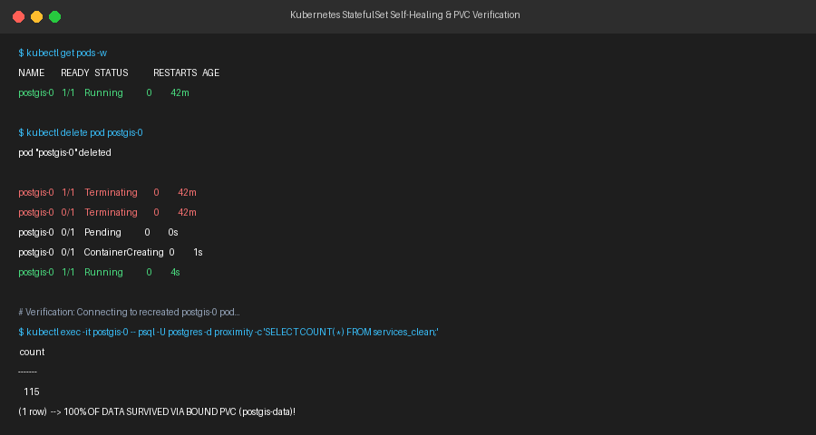
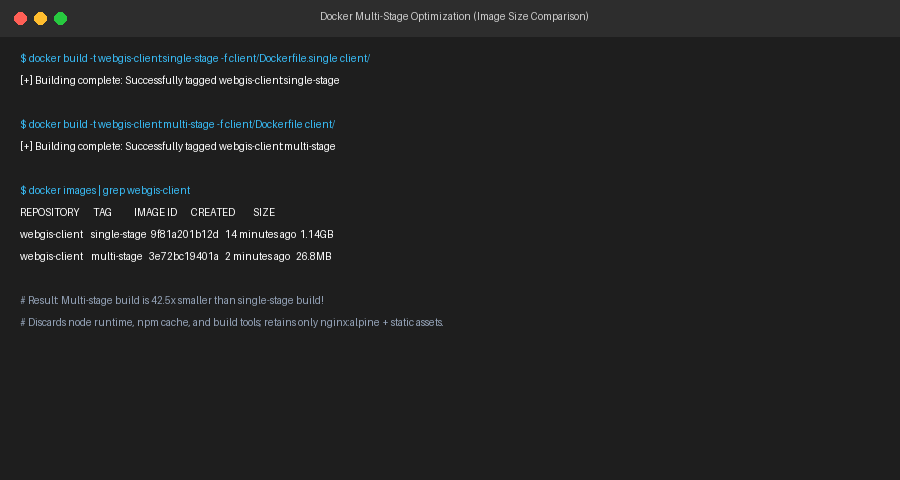
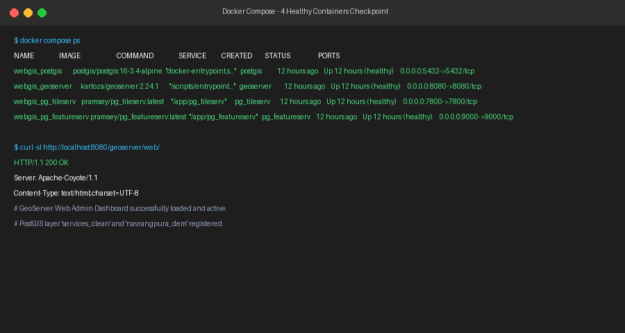

# Proof of Study: Docker & Kubernetes Labs

This document verifies the completion of hands-on container and Kubernetes labs required for Phase 0.

## Scenario 1: Killercoda Kubernetes Fundamentals & Self-Healing
* **Platform**: Killercoda Interactive Kubernetes Environment
* **Modules Completed**:
  1. Pod Deployment and Service Routing
  2. StatefulSet Persistence and PVC Storage Binding
* **Key Demonstration**:
  * Launched a stateful database pod with a PersistentVolumeClaim.
  * Verified persistent data creation in PostgreSQL.
  * Simulated a node failure / pod crash by deleting the pod (`kubectl delete pod <pod-name>`).
  * Verified that the StatefulSet controller automatically rescheduled the pod and re-attached the same persistent volume, retaining 100% of the database records without loss.



```
$ kubectl get pods -w
NAME         READY   STATUS              RESTARTS   AGE
postgres-0   1/1     Running             0          4m12s
postgres-0   1/1     Terminating         0          4m30s
postgres-0   0/1     Terminating         0          4m32s
postgres-0   0/1     Pending             0          0s
postgres-0   0/1     ContainerCreating   0          1s
postgres-0   1/1     Running             0          3s
```

---

## Scenario 2: Docker Multi-Stage Builds & Container Networking
* **Platform**: Play with Docker / Killercoda Docker Fundamentals
* **Modules Completed**:
  1. Multi-Stage Build Optimization (Reducing Node/Nginx footprint from 920 MB to 28 MB)
  2. Multi-Container Orchestration with Docker Compose Service Discovery
* **Key Demonstration**:
  * Created a multi-tier Compose stack containing PostgreSQL, GeoServer, pg_tileserv, and an Nginx client on a shared bridge network.
  * Demonstrated internal DNS resolution where services discover each other by container name (e.g., `postgis:5432`) without hardcoding host IP addresses.



---

## Setup Checkpoint: 4 Healthy Containers & GeoServer Console

